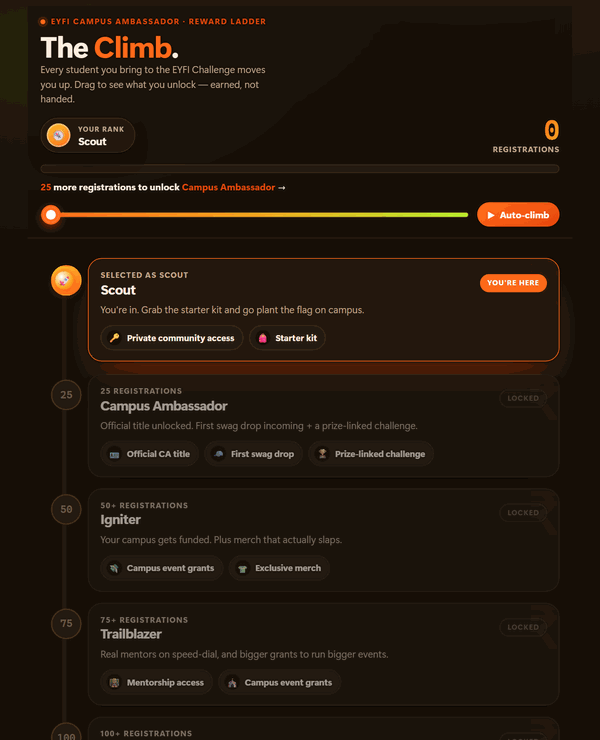

# EYFI Campus Ambassador — Reward Ladder 🪜

An interactive **reward ladder** for the [EYFI (Earn Your First Income) Challenge](https://eyfichallenge.com/)
Campus Ambassador program, built to match the live [ambassador.eyfichallenge.com](https://ambassador.eyfichallenge.com/)
design system exactly. Built as an assignment for Polygnan.

**▶ Live demo:** https://minianon.github.io/eyfi-ambassador-reward-ladder/

## What it does

Drag the slider (or hit **Auto-climb**) to grow your registration count. As you climb, the live
counter and rank update, the progress spine fills, each tier flips **locked → current → unlocked**,
and every milestone fires a **₹-coin confetti** burst. It's a self-contained HTML file — mobile-first,
keyboard-accessible, and respects `prefers-reduced-motion`.

## Tiers

| Milestone | Rank | Unlocks |
|---|---|---|
| Selected as Scout | Scout | Private community access + starter kit |
| 25 registrations | Campus Ambassador | Official CA title + badge, first swag drop, prize-linked challenge |
| 50+ registrations | Level up | Event grants for your campus + exclusive merch |
| 75+ registrations | Go further | Mentorship access + campus event grants |
| 100+ registrations | Paid Internship Opportunity | Paid internship opportunities + invite to ambassador events |
| 200+ registrations | Founding Team | Consideration for the EYFI Founding Team |

## Matching the brand

To make it look like a real slice of the production site, I extracted the live design system with a
headless browser and rebuilt against it (documented in [`BRAND_GUIDE.md`](BRAND_GUIDE.md)):

- **Colors** — dark charcoal + white dot-grid, lime `#C4F62E` primary, orange `#FF5A1F`, gold `#E8B923`
- **Type** — Bricolage Grotesque (display), Space Grotesk (body), Instrument Serif (italic accents), Open Sans
- **Signatures** — ✦ orange marquee ticker, chunky pressable lime pill buttons, floating 3D ₹ coins, `eyfi-float` / `eyfi-sphere-spin` / `eyfi-marquee` animations

## Files

- [`reward-ladder.html`](reward-ladder.html) / [`index.html`](index.html) — the page (self-contained, real Google Fonts)
- [`reward-ladder-demo.gif`](reward-ladder-demo.gif) / [`reward-ladder-demo.webm`](reward-ladder-demo.webm) — ~7s demo
- [`BRAND_GUIDE.md`](BRAND_GUIDE.md) — the EYFI design system / brand guide
- [`SUBMISSION.md`](SUBMISSION.md) — assignment note (tools & approach)

## Built with

Vanilla HTML/CSS/JS (no frameworks; confetti + coins are pure CSS/`<canvas>`), styled with the EYFI
tokens so it ports cleanly into their Tailwind/shadcn stack. Design system extracted with **Playwright**;
demo recorded headlessly with Playwright and assembled into a GIF with **Python/Pillow**.

## Author

Built by **Tushar Bhardwaj**. All my socials are here → https://link.minianon.in/tusharbhardwaj

## Design docs

| Doc | What's inside |
|---|---|
| [High-Level Design](docs/hld.md) | Architecture, components, data flow, tech choices, deployment |
| [Low-Level Design](docs/lld.md) | Modules, data models, APIs and functions, key sequences |

## License

Released under the [MIT License](LICENSE).
