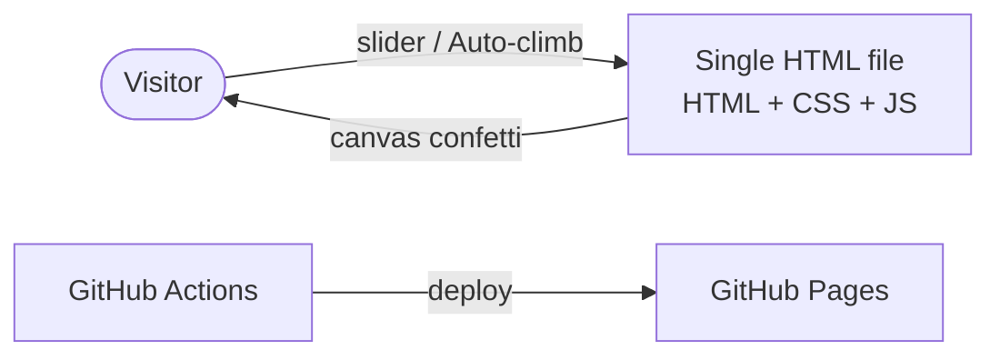

# EYFI Ambassador Reward Ladder: High-Level Design

An interactive reward ladder for the EYFI Campus Ambassador program: drag a slider (or press Auto-climb) to increase registrations and watch tiers unlock with coin confetti. Built as an assignment, matching the EYFI ambassador site's design. Live at [minianon.github.io/eyfi-ambassador-reward-ladder](https://minianon.github.io/eyfi-ambassador-reward-ladder/). For code-level detail see the [Low-Level Design](lld.md).

## 1. Context

## 2. Tiers

| Registrations | Tier | Reward |
|---|---|---|
| Selected | Scout | Private community access + starter kit |
| 25 | Campus Ambassador | Title + badge, first swag drop, prize-linked challenge |
| 50+ | Level up | Campus event grants + exclusive merch |
| 75+ | Go further | Mentorship + campus event grants |
| 100+ | Paid Internship Opportunity | Paid internships + ambassador event invites |
| 200+ | Founding Team | Consideration for the EYFI Founding Team |

## 3. Qualities

| Quality | How |
|---|---|
| Self-contained | One HTML file, no build or dependencies |
| Accessible | Keyboard-usable slider; honors `prefers-reduced-motion` |
| Mobile-first | Responsive layout; canvas scaled for device pixel ratio (max 2×) |
