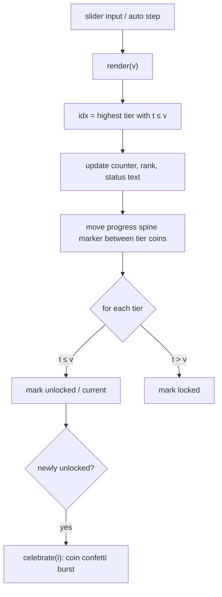

# EYFI Ambassador Reward Ladder: Low-Level Design

For the big picture see the [High-Level Design](hld.md).

## 1. Data

| Constant | Meaning |
|---|---|
| `TIERS` | `{ t, name, reward }` thresholds: 0, 25, 50, 75, 100, 200 |
| `MAX` | 220, the slider's maximum |
| `MQ` | Marquee phrases ("WAVE 01 SCOUTS", "₹2L IN PRIZES", …) |
| `unlocked` | Set of tier indexes already celebrated (starts with Scout) |
| `reduce` | `matchMedia("(prefers-reduced-motion: reduce)")` |

## 2. Render loop

## 3. Functions

| Function | Behavior |
|---|---|
| `idxFor(v)` | Index of the highest tier reached |
| `render(v)` | Updates text, spine fill and marker position (interpolated between the current and next tier coins), tier states |
| `celebrate(n)` | Confetti burst at the tier's coin (skipped when reduced motion is on) |
| Auto-climb | `requestAnimationFrame` loop adding 1.15 per frame until `MAX`; any manual slider move stops it |
| `burst(x, y)`, `tick()` | Canvas particles in the brand colors `#C4F62E`, `#E8B923`, `#FF5A1F`, `#A9D91A` |
| `size()` | Resizes the canvas to the window at up to 2× pixel ratio |

## 4. Files

| File | Role |
|---|---|
| `index.html` | The page (same content as `reward-ladder.html`) |
| `reward-ladder-demo.gif` / `.webm` | Demo recordings |
| `.github/workflows/static.yml` | GitHub Pages deploy |
